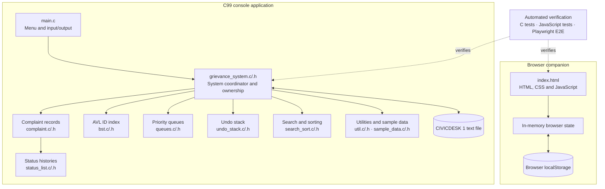
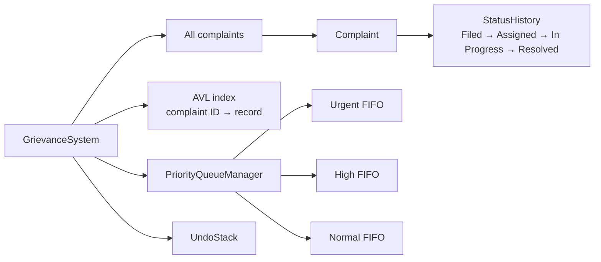
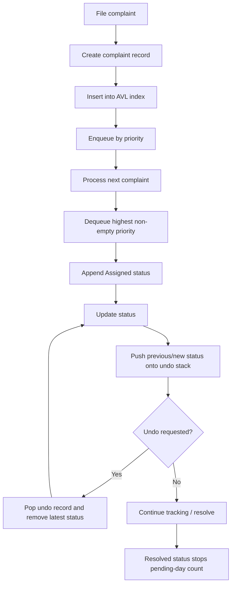

# CivicDesk Architecture

CivicDesk has two demonstration interfaces backed by equivalent complaint-management concepts:

- **C99 console application:** the primary implementation, with manually managed data structures and file persistence.
- **Browser dashboard:** a JavaScript companion for interactive demonstrations. It stores browser data in `localStorage`; it does not connect to the C process or a remote service.

This is an educational, single-user demonstration. It is not connected to a government service and should not be used with real personal data.

## High-level architecture

## C application responsibilities

| Module | Responsibility |
|---|---|
| `main.c` | Console menu, input handling and user-facing actions |
| `grievance_system.c/.h` | Coordinates the structures, owns the complaint collection, and handles save/load |
| `complaint.c/.h` | Complaint record, priority and department data |
| `bst.c/.h` | AVL tree index keyed by complaint ID |
| `queues.c/.h` | Three linked FIFO queues for Urgent, High and Normal |
| `status_list.c/.h` | Per-complaint singly linked status history |
| `undo_stack.c/.h` | Linked-list stack for reversing the latest status update |
| `search_sort.c/.h` | Linear and binary search, five sorting algorithms and benchmarks |
| `util.c/.h` | Allocation, string and date helpers |
| `sample_data.c/.h` | Demonstration records and benchmark data |

## How a complaint is represented

The system keeps a master collection of complaint records. The AVL tree indexes those records by ID; the waiting queues reference complaints that are awaiting processing; each complaint owns its own status history. The undo stack stores the information needed to reverse the most recent manual status change.

## Complaint lifecycle

## Browser companion

The browser dashboard is a separate JavaScript implementation intended for quick demonstrations. It supports filing, processing, status updates, undo, search, sorting, dashboard metrics, import/export and persistence through `localStorage`. It does not call the C executable, share its in-memory structures, or synchronize data with another user.

## Persistence and data boundaries

- The C application saves and loads the documented `CIVICDESK 1` text format when the user selects the corresponding menu options.
- The browser companion stores its state in that browser's `localStorage`; browser data is separate from C save files until explicitly exported/imported.
- The sample names, areas and complaint details are fictional.
- No network API, government database or multi-user backend is part of this version.

## Verification

The repository includes:
- C unit/integration tests in `test_civicdesk.c`.
- Browser-side JavaScript tests in `tests/civicdesk.test.cjs`.
- Chromium end-to-end tests in `tests/e2e/civicdesk.spec.cjs`.
- GitHub Actions jobs for C/JavaScript tests, AddressSanitizer + UndefinedBehaviorSanitizer, and Playwright browser tests.

See [TESTING.md](TESTING.md) for local commands and CI details.
